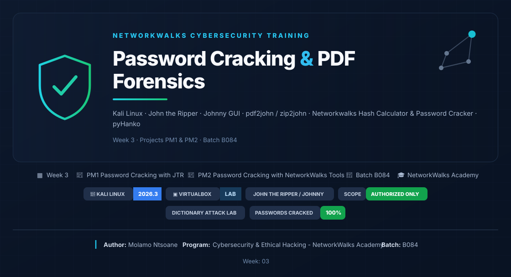
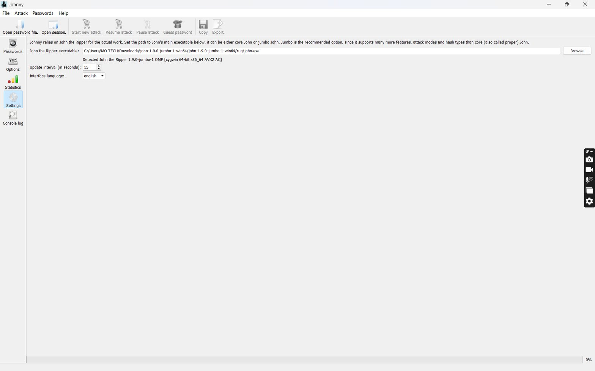
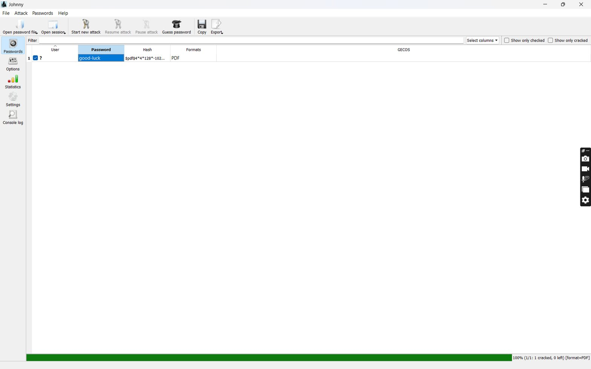
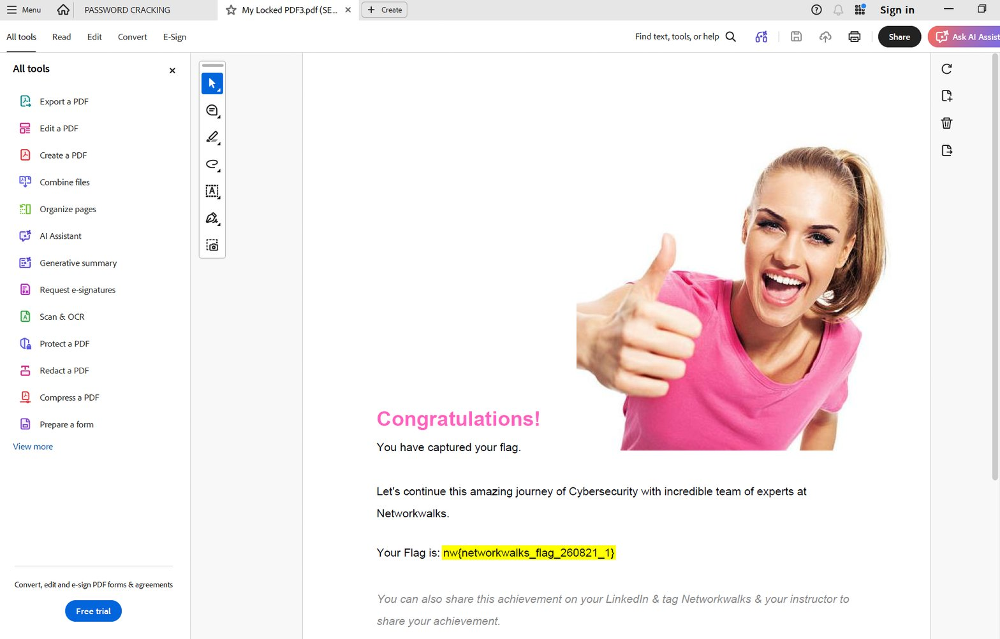
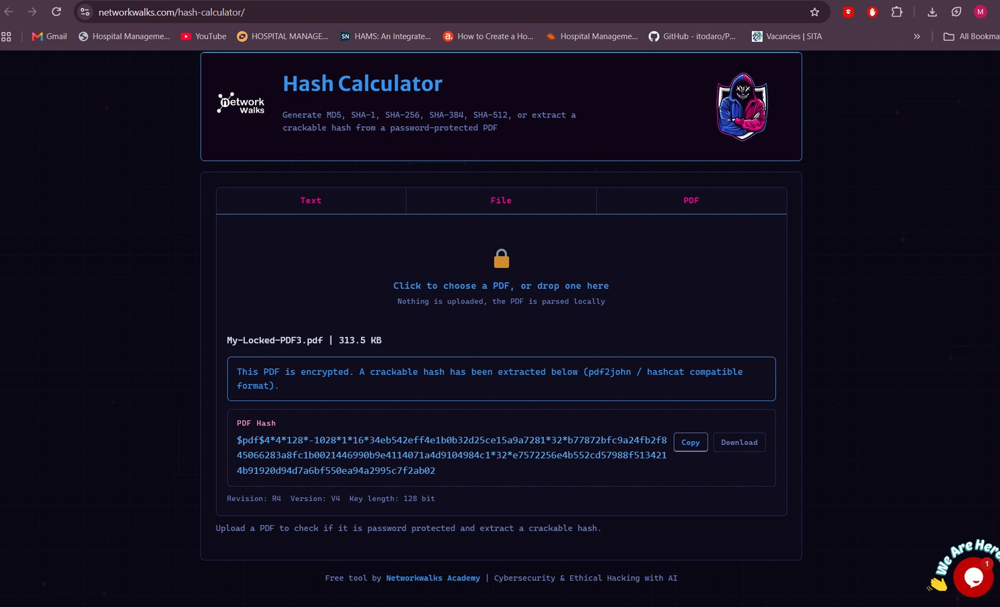
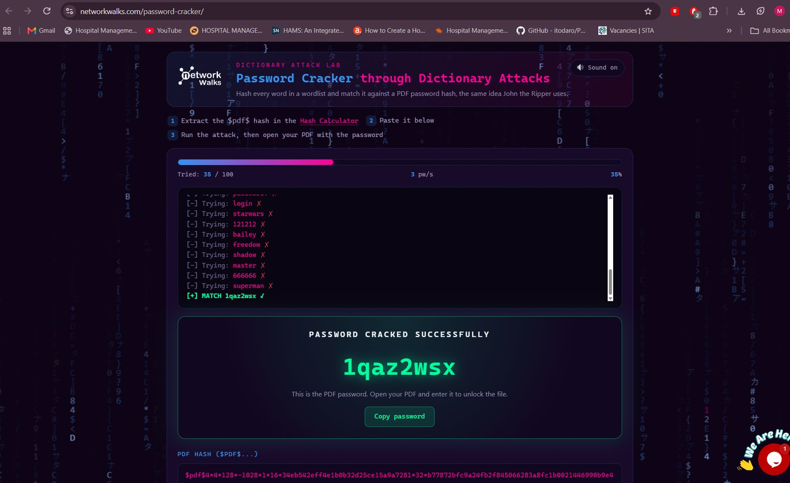
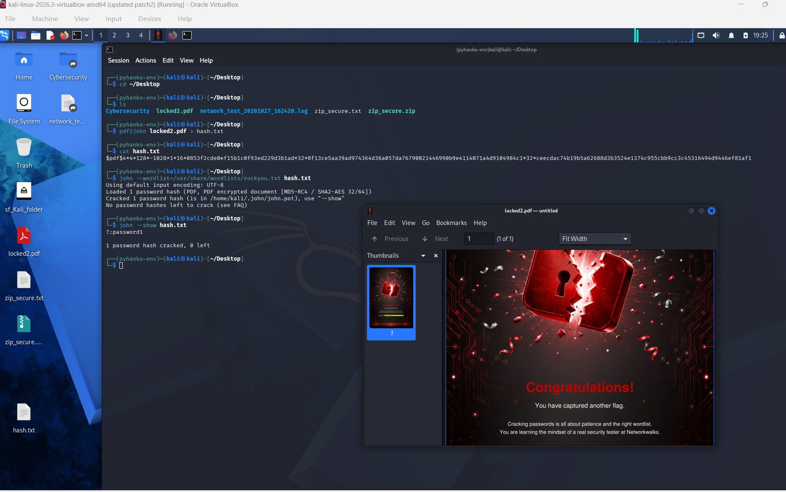

<p align="center">
  
</p>

# NetworkWalks-B084-WK3-PM1-PM2-Password-Cracking-Lab

## Week 3 — Password Cracking Lab

**John the Ripper · Johnny GUI · Networkwalks tools · Kali Linux**

A clear record of the Week 3 cybersecurity lab activities: extracting password hashes, running dictionary attacks in an authorised lab environment, and documenting the results with screenshots.

> **Lab use only:** Perform password-recovery tests only on files and systems you own or have explicit permission to assess.

## Contents

- [Project overview](#project-overview)
- [Repository structure](#repository-structure)
- [Module 1 -John the Ripper and Johnny](#module-1--john-the-ripper-and-johnny)
- [Module 2 -Networkwalks browser tools](#module-2--networkwalks-browser-tools)
- [Bonus - Kali Linux](#bonus--kali-linux)
- [Key lessons](#key-lessons)
- [Tools and references](#tools-and-references)

## Project overview

A password-protected document or archive can contain a verifier in the form of a **password hash**. In this lab, a hash is extracted from the authorised test file and supplied to a password-auditing tool. The tool tests candidate passwords until it finds a match.

The work is organised into three parts:

1. **Module 1:** Use John the Ripper (JTR) and its Johnny graphical interface on Windows.
2. **Module 2:** Use the Networkwalks Hash Calculator and Password Cracker in a browser.
3. **Bonus:** Use `pdf2john`, `zip2john`, John the Ripper and the `rockyou` wordlist on Kali Linux.

## Repository structure

```text
NetworkWalks-B084-WK3-PM1-PM2-Password-Cracking-Lab/
├── README.md
├── assets/
│   └── header.svg
├── hashes/
│   ├── hash1.txt
│   ├── hash2.txt
│   ├── hash3.txt
│   ├── locked1_pdf.txt
│   └── pdf1_hash.txt
└── screenshots/
    ├── 01_hash_calculator_pdf1.png
    ├── 02_password_cracker_success.png
    ├── 03_johnny_settings_john_exe.png
    ├── 04_johnny_cracked_good-luck.png
    ├── 05_pdf1_opened_flag.png
    └── 06_kali_john_rockyou.png
```

**Folders**

- `assets/` — project banner.
- `hashes/` — hash files and captured cracking output from the lab.
- `screenshots/` — visual evidence of the steps and results.

## Module 1 — John the Ripper and Johnny

**Task:** Recover the password for the lab PDF (`My Locked PDF1.pdf`) using John the Ripper and Johnny on Windows.

### Steps performed

1. Downloaded the Jumbo version of John the Ripper and the Johnny GUI.
2. Opened Johnny settings and selected `john.exe` from the John installation's `run` folder.
3. Confirmed that Johnny detected John the Ripper.
4. Loaded the file containing the extracted PDF hash.
5. Started the password audit and checked the **Passwords** tab for the result.

### Result

| Item | Result |
|---|---|
| Target | `My Locked PDF1.pdf` |
| Hash type | PDF (`$pdf$` format) |
| Tool | Johnny / John the Ripper 1.9.0-jumbo-1 |
| Status | 1 hash recovered; 0 remaining |
| Lab result | `good-luck` |

The recovered lab password opened the PDF and displayed the captured flag page.

### Screenshots & Evidence

**1. Johnny Configuration — John.exe**



**2. Password Successfully Recovered**



**3. PDF Successfully Opened — Flag Verification**



## Module 2 — Networkwalks browser tools

**Task:** Use the Networkwalks Hash Calculator and Password Cracker to audit the same lab PDF.

### Steps performed

1. Opened the authorised lab PDF in the Networkwalks Hash Calculator.
2. Extracted the PDF hash and copied the complete value.
3. Opened the Networkwalks Password Cracker and pasted the hash.
4. Ran the dictionary attack and reviewed the result.

### Result

| Item | Result |
|---|---|
| Target | `My Locked PDF1.pdf` |
| Hash type | PDF (`$pdf$` format) |
| Tools | Networkwalks Hash Calculator and Password Cracker |
| Attack type | Dictionary attack |
| Lab result | `1qaz2wsx` |
| Captured flag | `nw{networkwalks_flag_260821_1}` |

The recovered password opened the PDF and displayed the congratulations page.

### Screenshots & Evidence

**1. NetworkWalks Hash Calculator — PDF Hash Extraction**



**2. NetworkWalks Password Cracker — Successful Result**



## Bonus — Kali Linux

The bonus activity used John the Ripper from the Kali Linux terminal.

### PDF hash workflow

```bash
cd ~/Desktop
ls

# Extract the PDF hash from the authorised lab file
pdf2john locked2.pdf > hash.txt

# Review the extracted hash
cat hash.txt

# Run a dictionary audit with the rockyou wordlist
john --wordlist=/usr/share/wordlists/rockyou.txt hash.txt

# Display any recovered result
john --show hash.txt
```

The PDF hash was recovered during the lab and the document opened successfully.

### ZIP hash workflow

The ZIP archive activity used `zip2john` to extract a hash from `zip_secure.zip`. The resulting `$pkzip2$` hash was saved in `hashes/hash2.txt`.

```bash
zip2john zip_secure.zip > zip_secure.txt
john --wordlist=/usr/share/wordlists/rockyou.txt zip_secure.txt
john --show zip_secure.txt
```

Use these commands only with your own archive or an archive you are authorised to test. The ZIP workflow is documented here; the repository's `hashes/` folder contains the captured lab hash files.

### Screenshots & Evidence

**1. Kali Linux — John the Ripper Dictionary Attack**



## Key lessons

- A password hash must be extracted before an offline password audit can be performed.
- Dictionary attacks test candidate words from a wordlist; weak or commonly used passwords are more likely to be recovered.
- John the Ripper supports multiple hash formats, including PDF and ZIP formats when the correct extraction tools are used.
- Johnny provides a graphical interface, while John the Ripper can also be operated from the command line.
- Strong, unique passwords that are not based on common words are more resistant to dictionary attacks.

## Tools 

- [John the Ripper — Openwall](https://www.openwall.com/john/)
- [Johnny GUI — Openwall](https://openwall.info/wiki/john/johnny)
- [Networkwalks Hash Calculator](https://networkwalks.com/hash-calculator/)
- [Networkwalks Password Cracker](https://networkwalks.com/password-cracker/)
- [Networkwalks password-cracking lab](https://networkwalks.com/project-task-lab-password-cracking-with-networkwalks-tools/)

## Reference 

- [ ] Sponsored by: NetworkWalks Academy
- [ ] Mentor and Instructor: Waqas Karim (CCIE)
- [ ] Email: waqasulkarim@gmail.com

## ⚠️ Disclaimer

All activities were performed only against the authorized lab target provided by the course, my own lab environment, or networks and devices I own. This project is for **educational and cybersecurity learning purposes** only.

---

⭐ Part of my continued hands-on journey in **Cybersecurity, Ethical Hacking and Penetration Testing**.

---

**Week 3 Cybersecurity Lab** · Password Cracking · Learning and evidence repository
